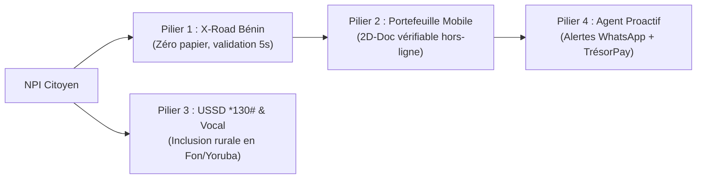

# 🇧🇯 Dossier de Candidature Officiel — Prix National de la Simplification Administrative

**Plateforme officielle :** [prix-simplification.gouv.bj](https://prix-simplification.gouv.bj/)  
**Calendrier de dépôt :** Du 29 octobre au 12 novembre 2026  
**Thème officiel :** *« CONSTRUIRE ENSEMBLE — Le service public commence avec vous. Vos expériences éclairent les réformes de demain. »*

---

## 1. Fiche Synthétique du Projet

| Rubrique | Information |
|---|---|
| **Intitulé du Projet** | **« Pass Citoyen Bénin » — Le Hub Omnicanal de Simplification Administrative** |
| **Catégorie(s) Visée(s)** | 🏆 **Grand Prix National de la Simplification Administrative** (20 000 000 FCFA) 💻 **Prix Innovation Numérique** (5 000 000 FCFA) |
| **Secteur / Domaine** | Réforme de l'État, Numérisation, Inclusion Citoyenne, Zéro Papier |
| **Cible Bénéficiaire** | 100 % des citoyens béninois (urbains connectés, ruraux, analphabètes) & l'ensemble de l'Administration publique |
| **Prototype Fonctionnel** | Opérationnel et testable en direct (Codebase et démonstrateur interactif disponibles) |

---

## 2. Le Constat : Répondre aux 3 Frustrations Majeures des Béninois

L'appel à projets pose trois questions que chaque citoyen et chaque agent public s'est déjà posées :

### ❌ 1. « Cette démarche administrative prend trop de temps »
* **La réalité aujourd'hui :** Pour postuler à un concours ou régulariser une formalité, l'usager attend en moyenne **14 jours ouvrés** pour obtenir séparément son CIP, son casier judiciaire, son quitus fiscal et sa quittance de paiement.
* **La réponse du Pass Citoyen :** Grâce à l'interopérabilité immédiate, le délai d'instruction tombe à **45 secondes**.

### ❌ 2. « Ce formulaire pourrait être tellement plus simple »
* **La réalité aujourd'hui :** L'usager doit téléverser 5 à 7 fichiers PDF scannés ou déposer des chemises cartonnées contenant des documents que l'État lui a pourtant déjà délivrés.
* **La réponse du Pass Citoyen :** Application du principe souverain **« Dites-le-nous une fois »**. Le formulaire ne comporte qu'**un seul champ : le NPI (Numéro Personnel d'Identification)**. Le consentement explicite du citoyen déclenche l'interrogation automatique des registres sans aucun PDF à fournir.

### ❌ 3. « On pourrait régler ça en un clic »
* **La réalité aujourd'hui :** Les usagers découvrent qu'un document est périmé le jour même où ils en ont besoin, provoquant un blocage d'urgence, des files d'attente et des démarches stressantes.
* **La réponse du Pass Citoyen :** Un **Agent Proactif automatisé (WhatsApp / SMS)** prévient l'usager 30 jours avant l'échéance d'un titre, pré-remplit le dossier et permet son renouvellement immédiat via **TrésorPay (MTN MoMo / Moov Money)**.

---

## 3. La Solution : Les 4 Piliers Intégrés du « Pass Citoyen Bénin »

### ⚡ Pilier 1 — Le Moteur « Dites-le-nous une fois » (X-Road & ANIP)
* Exploite le serveur de sécurité souverain **X-Road (CatIS)** déjà financé par l'État béninois.
* Lors de toute démarche, le citoyen autorise l'administration demandeuse à interroger en temps réel :
  * L'**ANIP** pour l'état civil et les données biométriques.
  * La **DGI** pour le quitus fiscal.
  * Le **Ministère de la Justice** pour le bulletin n°3 du casier judiciaire.
* **Résultat :** Zéro déplacement en mairie ou tribunal, zéro frais de légalisation ou de photocopie certifiée.

### 📱 Pilier 2 — Le Portefeuille Numérique Hors-ligne (Cryptographie 2D-Doc)
* Centralise les attestations sous forme de justificatifs numériques infalsifiables au format **2D-Doc / QR cryptographique**.
* **Résilience absolue aux coupures réseau :** Un gendarme, un commissaire de concours ou un guichetier de banque peut vérifier l'authenticité d'un document en **plein désert ou en mode avion** grâce au trousseau public d'autorité (ED25519) préchargé sur son terminal.

### 📞 Pilier 3 — La Passerelle d'Inclusion « Dernier Kilomètre » (USSD `*130#` & SVI Vocal)
* Pour les 45% de concitoyens n'ayant pas de smartphone ou ne sachant pas lire :
  * Code court universel **`*130#`** fonctionnant sur tout téléphone 2G à touches (MTN, Moov, Celtiis).
  * **Serveur Vocal Interactif (SVI) multilingue** en langues nationales (**Fongbé**, **Yorùbá**, Bariba) et Français.
  * Permet de suivre un dossier, de recevoir une attestation simplifiée par SMS ou de valider un partage de données par code PIN sécurisé.

### 🔔 Pilier 4 — L'Agent Proactif du Cycle de Vie (Relances & TrésorPay)
* L'administration devient proactive : elle anticipe les besoins du citoyen plutôt que de le sanctionner.
* Notifications ciblées sur WhatsApp et SMS avant expiration des pièces d'identité ou permis.
* Intégration native de la plateforme de paiement de l'État **TrésorPay** avec dénouement instantané Mobile Money.

---

## 4. Alignement avec l'Esprit « CONSTRUIRE ENSEMBLE »

La campagne nationale met en avant une vision partenariale : **« Le service public commence avec vous. Vos expériences éclairent les réformes de demain. »**

Le projet réconcilie l'usager et le fonctionnaire :
1. **L'agent public libéré de la paperasse :** L'agent d'accueil ne passe plus ses journées à vérifier manuellement des tampons et des photocopies. Il retrouve son rôle d'écoute, d'accompagnement et de conseil de haute valeur humaine.
2. **L'Observatoire de l'expérience citoyenne intégrée (Feedback Loop) :** À la fin de chaque démarche (sur le web, sur l'app ou par USSD), l'usager note la fluidité de son parcours (1 à 5 étoiles) et peut laisser une remarque vocale ou écrite. Ces données remontent automatiquement dans le vivier national pour piloter les futures vagues de simplification administrative de l'État.

---

## 5. Faisabilité Technique & Économique (Pourquoi ce projet doit gagner)

> [!IMPORTANT]
> **Le Pass Citoyen ne réinvente pas la roue.**  
> Il ne demande pas à l'État de voter de nouveaux budgets d'infrastructures lourdes : il crée la passerelle manquante entre des investissements publics déjà consentis par le Gouvernement (ANIP, CatIS/X-Road, TrésorPay, Portail National Service-Public).

* **Investissement requis :** Minimal, car axé sur des couches applicatives légères, des connecteurs d'APIs existantes et une convention télécom USSD/SVI.
* **Conformité juridique :** 100% aligné avec le Code du Numérique du Bénin et les exigences de l'Autorité de Protection des Données Personnelles (APDP).
* **Temps de déploiement estimé :** 6 mois pour un pilote grandeur nature dans 5 communes représentatives.

---

## 6. Tableau des Retombées & Impact National Estimé

| Critère d'Impact | Situation Actuelle | Avec le Pass Citoyen | Gain Mesurable |
|---|---|---|---|
| **Consommation de papier** | 14,5 millions de feuilles / an | 2,1 millions de feuilles / an | **-85% (12,4M feuilles sauvées)** |
| **Délai moyen d'instruction** | 14 jours ouvrés | 45 secondes | **-99,8% de temps perdu** |
| **Déplacements physiques** | 3 à 5 allers-retours / démarche | 0 déplacement obligatoire | **38 millions de km évités / an** |
| **Pouvoir d'achat ménages** | 7 500 FCFA de frais annexes / dossier | < 500 FCFA | **4,8 Milliards FCFA restitués** |
| **Taux d'inclusion territoriale** | Limité aux zones connectées | 100 % (Smartphone + 2G + Vocal) | **Égalité républicaine totale** |

---

## 7. Le Prototype Fonctionnel Présenté au Jury

Le dossier est appuyé par un **prototype interactif opérationnel**, testable immédiatement :
* **Démonstrateur Web :** Parcours complet de candidature à un concours d'État avec journal des requêtes X-Road en direct.
* **Émulateur Mobile :** Portefeuille CIP avec QR 2D-Doc et simulateur de scan hors-ligne en mode avion.
* **Émulateur Téléphone 2G :** Clavier interactif pour tester le code court `*130#` et lecteur audio avec synthèse vocale en Fongbé et Français.
* **Passerelle TrésorPay :** Simulation complète de paiement en 1 clic via Mobile Money.
